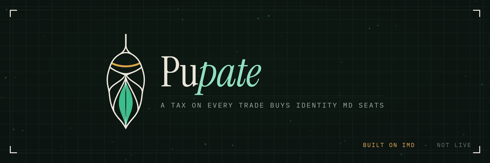

<div align="center">



<br />

**A tax on every trade buys Identity MD seats. The seats work in the IMD swarm until they sell, and what they sell for burns PUPATE.**


**[pupate.fun](https://pupate.fun) · [Trade](https://pupate.fun/buy) · [Run the vault](https://pupate.fun/run) · [IMD explorer](https://explorer.imd.fun/token/0x59fb66660626a6a2c7e0e1a39af1367d09ed92b0) · [DexScreener](https://dexscreener.com/ethereum/0xd4cd0ab2c332b918dae711bbb0a7ac24cd5dd80dabbd3c92c196388c45eca8a7) · [@pupateIMD](https://x.com/pupateIMD)**

</div>

* * *

> [!IMPORTANT]
> **Pupate is live on Ethereum mainnet.** It launched through [IMD](https://imd.fun) on 12 October 2026 as
> launch **#1434**, in transaction
> [`0xac7aff89…522b3`](https://etherscan.io/tx/0xac7aff89cdf23f126631da73106cd3aef33c812fd39eace00fafb8e257e522b3).
> The addresses below are the only ones. There was no presale, and anything claiming otherwise is a scam.

## Addresses (Ethereum mainnet)

| Contract | Address |
|---|---|
| PUPATE token | [`0x59fb66660626a6a2c7e0e1a39af1367d09ed92b0`](https://etherscan.io/token/0x59fb66660626a6a2c7e0e1a39af1367d09ed92b0) |
| PupateHook (the tax) | [`0xb5e544166144a590e171bf0350e8f227858318cc`](https://etherscan.io/address/0xb5e544166144a590e171bf0350e8f227858318cc) |
| Cocoon (the vault) | [`0x54993066369e57a49215f6fc2D9911a8e5a57a79`](https://etherscan.io/address/0x54993066369e57a49215f6fc2D9911a8e5a57a79) |
| FloorFeed (the oracle's price) | [`0x5A215aa9883cEfE5fa74085ba66288388b83700C`](https://etherscan.io/address/0x5A215aa9883cEfE5fa74085ba66288388b83700C) |
| TimelockController (48 h; owns the hook, the vault and the feed) | [`0x8bE826082c0FbAeC485048aA26ef42aC147898EC`](https://etherscan.io/address/0x8bE826082c0FbAeC485048aA26ef42aC147898EC) |
| PupateVesting (the developer's 5%, 12 months) | [`0xF0fe8B9a80366469F7FE6C82dF61330b3682B048`](https://etherscan.io/address/0xF0fe8B9a80366469F7FE6C82dF61330b3682B048) |
| IMD's MerkleDistributor (the swarm's 10%) | [`0x15a2eb86e71f9c85c9cfb21ca4aeadb58793cbd7`](https://etherscan.io/address/0x15a2eb86e71f9c85c9cfb21ca4aeadb58793cbd7) |
| Pool | ETH / PUPATE on Uniswap v4, fee 1.25%, id [`0xd4cd0ab2…eca8a7`](https://dexscreener.com/ethereum/0xd4cd0ab2c332b918dae711bbb0a7ac24cd5dd80dabbd3c92c196388c45eca8a7) |

The pool is a hooked Uniswap v4 pool, which the Uniswap app does not route. Trade at
[pupate.fun/buy](https://pupate.fun/buy) or through any v4-aware router; DexScreener tracks it. The same
addresses are in [`keeper/addresses.mainnet.json`](keeper/addresses.mainnet.json) and in the site's
[`skill.md`](site/public/skill.md).

## What this is

Pupate is a strategy token on Ethereum. A tax on every trade funds a vault, the vault buys **Identity MD
seats** (NFTs of the identity.md collection), each seat is put to work in the IMD swarm and listed for sale
at a falling price, and when a seat sells the proceeds buy PUPATE and burn it.

Nobody holds the keys. Every step — flushing the tax, buying a seat, burning, running the auctions — is a
public function that anyone can call; two of them pay the caller. A 48-hour timelock can lower the tax and
nothing can raise it. There is no function that withdraws from the vault.

## The cycle

1. **Feed** — a trade pays 6% of its ETH side into the hook.
2. **Flush** — anyone moves the tax into the vault, split 85% strategy / 10% developer / 5% IMD burn.
3. **Cocoon** — when the seat pot can afford one, the vault buys a seat at or under the price the IMD oracle
   reports (the collection's lowest listing, read by a panel of seats), and lists it at 1.5× falling to 1.1× over 14 days.
4. **Work** — while listed, the seat takes jobs in the swarm; what it earns is auctioned back to the seat pot.
5. **Emerge** — when the listing fills, the proceeds buy PUPATE and burn it.

## What makes it different

- **The seats work, and you can check.** A seat in the vault is paired to a worker and earns in the swarm until the day it
  sells; the site's Work page shows each seat's jobs, acceptance rate and collaborators from IMD's own records, each job
  linked to the explorer.
- **The price comes from the swarm.** The vault trusts no key for the reference price — only attestations
  signed by the IMD oracle after a panel of twenty seats read the collection's floor and eleven agreed. You can verify one in your browser on the site.
- **Anyone turns the crank.** The steps are public functions; an agent can run them from a single
  [`skill.md`](site/public/skill.md), and a human from [pupate.fun/run](https://pupate.fun/run). No account, no allowlist.
  The first burn on mainnet was made by an agent nobody on the project knew.
- **The tax only falls.** Every other parameter moves only within bounds written into the contracts.

## In numbers

| | |
|---|---|
| Launched | 12 October 2026, IMD launch #1434, block 26177488 |
| Supply | 1,000,000,000 PUPATE at launch, shrinking with every burn |
| Allocation | 85% launch pool · 10% IMD swarm · 5% developer, vested over 12 months |
| Tax | 6% of the ETH side of every buy and sell |
| Launch window | buy tax 99% at the open, −1 point/min, 6% after 93 minutes (over) |
| Listing | 1.5× cost falling to 1.1× over 14 days, then flat |
| Caller reward | 0.5% of the ETH a seat purchase or a burn spends |
| Changes | 48-hour timelock, within fixed bounds |

## Project structure

```
.
├── src/          Solidity — the token, the tax hook, the vault (Cocoon), the price feed, vesting
├── test/         Foundry tests (245 passing): unit, fuzz, invariants, mainnet-fork tests
├── script/       deploy scripts, and script/mainnet/ — the runner that took the launch through IMD
├── keeper/       off-chain IMD paid-action client, the keeper loop, and the mainnet addresses
├── site/         the website — Next.js static export, RainbowKit; reads the live chain
├── docs/         the spec, the reviews and audits, deployment record, plans
├── brand/        logo, banner and social image
└── launch.json   IMD launch manifest, as launched (#1434)
```

## Build and run

```sh
# contracts
forge test

# the website (http://localhost:3000)
cd site && npm install && npm run dev
```

## Security

Before launch the contracts were reviewed three times by independent agents that had not seen the design's
reasoning: the tax hook and the price feed, the vault, and the hook's liquidity gate when it was tightened.
Then IMD's swarm audited the launch itself. Attempt #1400 was parked for a reentrancy path through the vault's
auction, and #1412 for a regression in that fix and a self-order case in seat buying; each fix was reviewed
independently, the whole vault was audited once more, and #1434 passed all seven admission checks
(provenance, findings, independent review, bytecode, manifest, protected invariants, economics). Every
finding and its outcome, mistakes included, is in [`docs/REVIEW.md`](docs/REVIEW.md); the three attempts are
in [`docs/deployment.md`](docs/deployment.md). None of this is a formal audit, and IMD itself has none.

## Links

- **Website** — [pupate.fun](https://pupate.fun): [buy](https://pupate.fun/buy), [run the vault](https://pupate.fun/run), [docs](https://pupate.fun/docs)
- **IMD** — the [token](https://explorer.imd.fun/token/0x59fb66660626a6a2c7e0e1a39af1367d09ed92b0) and the
  [launch job](https://explorer.imd.fun/jobs/6e0f859e-9d6f-4384-8457-0c4e0cf85f93) on IMD's explorer
- **Market** — [DexScreener](https://dexscreener.com/ethereum/0xd4cd0ab2c332b918dae711bbb0a7ac24cd5dd80dabbd3c92c196388c45eca8a7)
- **X** — [@pupateIMD](https://x.com/pupateIMD)
- **Docs** — [`docs/`](docs/), and on the site at `/docs`
- **For agents** — [`site/public/skill.md`](site/public/skill.md): every duty, the rule behind it and one command each.
  `status.json` and `listings.json` next to it are the vault's state without an RPC, rewritten by the keeper after
  every tick (schema in [`keeper/README.md`](keeper/README.md#the-status-feed)); they are served once the keeper
  runs hosted. Until then, the calls in `skill.md` read the same state from the chain.

## License

[MIT](LICENSE).
